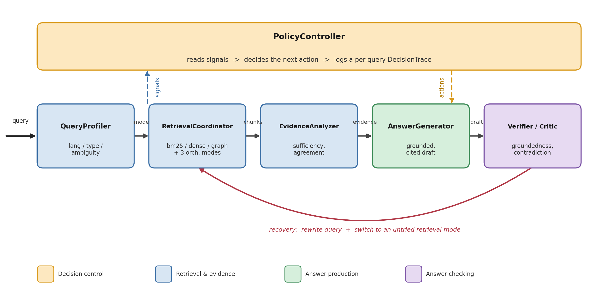

# Reliable and Adaptive Agentic RAG over the ETH Zurich Corpus
### Final Report — Advanced Generative AI Capstone (FS26)

**Authors:** Cyriel Van Helleputte, Vincent Schreyer
**Date:** 24 May 2026
**Code:** this repository — see §11 for how to reproduce every result.

---

## Abstract

We extend a strong multilingual multi-agent RAG baseline into a **reliable and
adaptive** agentic system that reasons about whether its evidence is sufficient,
whether its answer is grounded, and what to do when it is not. On the 25-question
benchmark the system produces **only grounded answers** (1.00 grounded-answer
rate, 0 unsupported claims per answer), **abstains** on unanswerable questions,
and uses **adaptive recovery** (query rewriting + retrieval-mode switching) that
nearly doubles answer coverage relative to a no-recovery ablation (0.81 vs 0.52).
Our central finding is that **groundedness guarantees faithfulness but not
correctness**: every answer is faithful to its retrieved evidence, yet accuracy
is bounded by retrieval quality, which remains the dominant error source carried
over from the baseline.

---

## 1. Introduction and objective

The task is to move beyond "retrieve and answer" toward a system that decides
*whether the answer should be trusted* and *how to react under uncertainty*. We
build on the previous semesters' RAG/multi-agent baseline and add mechanisms for
evidence-sufficiency estimation, groundedness verification, abstention, and
adaptive recovery, with contradiction detection, clarification, and a trust score
as additional components. The project follows the five prescribed steps; this
report synthesises them and reflects critically on what worked.

---

## 2. Baseline system (Step 1)

The baseline is **retrieval-only** and multilingual (EN/DE). It comprises three
retrievers — a bilingual BM25 (with M2M100 translation), a dense retriever
(`multilingual-e5-large-instruct` over a Chroma store), and a GraphRAG retriever
(community embeddings + chunk re-scoring) — combined under three fixed
orchestration strategies:

- **Waterfall** — BM25+Dense fused by weighted RRF; escalate to GraphRAG only if
  top-doc lexical overlap is low.
- **Voting** — all three retrievers fused in parallel by weighted RRF.
- **Confidence** — a FLAN-T5 query classifier (FACTOID/SEMANTIC/HYBRID) picks the
  fusion weights.

We reproduced the pipeline end-to-end (`src/baseline/`, `src/scripts/run_baseline.py`)
and confirmed it runs against the prebuilt artifacts. Reference configuration:
**Confidence** (best MRR 0.205 and lowest latency ~1 s).

| Strategy | P@5 | Recall@5 | MRR | Latency avg |
|---|---|---|---|---|
| Waterfall | 0.058 | 0.003 | 0.161 | 2.37 s |
| Voting | 0.100 | 0.004 | 0.190 | 13.66 s |
| **Confidence** | **0.117** | **0.005** | **0.205** | **0.96 s** |

---

## 3. Failure analysis (Step 1)

We classified each (query, strategy) outcome into a taxonomy
(`results/baseline/failure_report.md`). Key observations:

- **No `success` outcomes** and very low Recall@5 — most benchmark questions have
  many gold chunks (tens to hundreds), so top-5 recall is structurally tiny.
- **`ranking_failure` dominates** (13–16 of 24 per strategy): the gold evidence is
  usually somewhere in the top-100 but not the top-5.
- **`partial_recall`** (5–9 per strategy): some gold retrieved, not enough.
- **`retrieval_failure`** (2–3, e.g. Q6 *e-sling*, Q22): zero gold even in top-100.
- **`orchestration_miss`**: one strategy missed a query another would have caught.
- **3 ambiguous-by-design** questions whose ideal behaviour is to clarify.
- **Synthesis / grounding / overconfidence / contradiction failures are
  unobservable** in a retrieval-only system — they require an answer layer.

These directly motivate the extensions: ranking/partial failures motivate
**sufficiency estimation + recovery (rerank/mode-switch)**; retrieval failures
motivate **query rewriting + abstention**; the ambiguous questions motivate
**clarification**; and the unobservable failures motivate adding an
**answer generator + verifier + trust score**.

---

## 4. Proposed architecture (Step 2)

We redesigned the baseline into a **reliability-aware multi-agent system**
(`docs/step2_design.md`). Six specialised agents read/write a shared `RunState`
blackboard, and a **PolicyController** decides the next action at each step,
recording a human-readable reason in a per-query **DecisionTrace**.



*The query flows left to right through the agent pipeline; the **PolicyController**
reads the signals each stage produces and decides the next action (generate,
recover, clarify, abstain, or answer), logging its reason to a per-query
DecisionTrace. On weak or ungrounded evidence the **recovery** loop rewrites the
query and switches to an untried retrieval mode.*

The architecture **separates answer production (`AnswerGenerator`) from answer
checking (`Verifier`) from decision control (`PolicyController`)** — the verifier
may judge but not rewrite; the controller decides but never retrieves, generates,
or judges directly. The LLM-backed agents call **Claude** (`claude-opus-4-7` for
generation/verification, `claude-haiku-4-5` for profiling/rewriting) through one
wrapper (`src/agentic/llm.py`) with structured outputs, prompt caching, and
token/cost accounting.

### Reliability signals

| Signal | Source | Threshold |
|---|---|---|
| `sufficiency` | embeddings (query↔chunk relevance, entity coverage, agreement) | < 0.40 → low |
| `chunk_agreement` | embeddings (pairwise) | reported |
| `grounding` | Claude verifier | < 0.60 → ungrounded |
| `contradiction` | Claude verifier | > 0.50 → conflict |
| `ambiguity` | profiler | == 1 → clarify (guarded, see §6) |
| `confidence` | `0.4·suff + 0.4·grounding + 0.2·(1−contradiction)` | reported |

---

## 5. Reliability mechanisms (Step 3)

Implemented in `src/agentic/` (see `docs/step3_progress.md`). The four required
mechanisms plus three bonus ones:

- **(A) Evidence sufficiency** — `EvidenceAnalyzer` gates generation on a local
  embedding-based sufficiency score.
- **(B) Groundedness verification** — `Verifier` (Claude judge) returns
  `grounded`, `grounding_score`, and `unsupported_claims`.
- **(E) Abstention** — explicit ABSTAIN action tied to low sufficiency/grounding
  with no retries left.
- **(G) Adaptive recovery** — the orchestration-changing mechanism (see §6).
- **(C) Contradiction detection** ⭐ — `contradiction_score` from the verifier.
- **(D) Clarification** ⭐ — ambiguous queries route to a generated clarifying question.
- **(F) Self-reflection / critique** ⭐ — the verifier reviews the draft and the
  policy acts on its verdict.
- **(H) Trust / confidence score** ⭐ — reported with every answer.

The `AnswerGenerator` is prompted to answer **only** from the chunks, cite chunk
ids, and declare when evidence is absent rather than guessing — giving the policy
a clean signal to recover or abstain.

---

## 6. Adaptation logic (Step 3)

The PolicyController is a state machine with a bounded retry budget (2). The
**adaptation requirement** is met by recovery, whose behaviour changes
dynamically with the detected failure:

1. **Per-query initial mode** by query type (`entity→bm25`, `list→voting`,
   `definition→dense`, `opinion→confidence`, `multihop→graphrag`).
2. On **low sufficiency** or an **ungrounded draft** with retries left, the
   controller **rewrites the query** (LLM expansion/translation) and **switches to
   a retrieval mode not yet tried**, avoiding repeats.
3. **Ambiguity** routes to clarification — but only when retrieval did *not*
   already yield strong evidence (`clarify_sufficiency_max = 0.65` guard, added
   after a calibration fix; see §7).
4. With no retries left, the controller **abstains** rather than emit an
   unreliable answer.

Every decision and its reason are written to the DecisionTrace
(`results/agentic/traces/<qid>.json`), satisfying the interpretability requirement.

---

## 7. Experiments and results (Step 4)

Full methodology and tables in `docs/step4_evaluation.md`. Highlights:

**Metrics rationale.** Retrieval quality is measured with P@5, Recall@5, and
MRR — the same family as Step 1, enabling direct comparison. Answer quality is
measured with LLM-judged correctness (correct / partially correct / incorrect)
rather than BLEU or ROUGE: most benchmark answers are short factual strings or
open-ended lists where n-gram overlap is misleading, and semantic correctness
judged against gold by an LLM is a more reliable signal for this task type.
Reliability is measured with grounded-answer rate, unsupported-claim rate,
correct/false abstention rate, recovery success rate, and confidence calibration
(ECE) — metrics that have no counterpart in the retrieval-only baseline and
directly reflect the goals of the project.

**System vs. baseline.** The agentic system improves retrieval (P@5 0.142 vs
0.117, MRR 0.218 vs 0.205) — recovery + per-query mode switching pull more gold
into the top-5 than any fixed strategy — and adds the reliability layer:
**1.00 grounded-answer rate, 0 unsupported claims**, abstention on unanswerable
questions. Cost: ~29 s and ~$0.04 per query (vs ~1 s retrieval-only).

**Reliability behaviour (25 q).** 20 answer / 4 abstain / 1 clarify; answer
coverage on answerable questions 0.81; correct abstention 1/1; recovery success
7/11 (0.64). False-abstention rate 0.75 — three answerable questions were
declined because retrieval could not surface evidence that exists in the corpus.

**Groundedness ≠ correctness (central finding).** LLM-judged correctness of the
20 answers: 3 correct, 11 partial, 6 incorrect. Answers are faithful to retrieved
chunks but accuracy is bounded by *what was retrieved*.

**Confidence calibration (Extra-Challenge #2).** The reported confidence is
**severely overconfident**: mean confidence 0.89 vs. mean graded correctness 0.42,
giving an **Expected Calibration Error of 0.47** (reliability diagram in
`results/agentic/confidence_calibration.png`). The cause is structural — confidence
is dominated by grounding, which saturates near 1.0 on every answer, so the score
cannot tell a correct answer from a faithful-but-wrong one.

**Ablation study.**

| Config | Answer coverage | Abstentions | Recovery success | Grounded |
|---|---|---|---|---|
| full | **0.81** | 4 | 0.64 | 1.00 |
| no_recovery | **0.52** | 10 | — | 1.00 |
| no_abstain | 0.95 | 0 | 1.00 | 1.00\* |
| no_clarify | 0.86 | 4 | 0.64 | 1.00 |

Recovery is the highest-value mechanism (coverage 0.81→0.52 when removed).
Abstention trades coverage for honesty (\*`no_abstain`'s extra "answers" are
vacuous "the evidence is silent" responses). Clarification has little effect on
the original benchmark at the current conservative calibration.

**Benchmark extension (15 reliability-focused cases).** The original 25-question
benchmark tests factual question answering but does not exercise the new
reliability mechanisms directly — it has only 1 unanswerable question, 3
ambiguous-by-design questions, and no injected conflicts or adversarial premises.
We designed a 15-case extension (`Baseline/benchmark/benchmark_reliability.json`)
to specifically probe the five failure modes our system is built to handle:

| Category | Cases | Design intent |
|---|---|---|
| Ambiguous | R1–R3 | Under-specified queries with multiple valid referents — should trigger clarification |
| Insufficient evidence | R4–R6 | Questions about entities not in the ETH corpus — should trigger abstention |
| Conflicting evidence | R7–R9 | Questions where the corpus contains time-shifted figures — tests contradiction detection |
| Adversarial / false premise | R10–R12 | Questions with a factually incorrect premise embedded — system must not confabulate |
| Multilingual / code-switched | R13–R15 | Queries mixing German and English — tests bilingual robustness |

Each case includes an `expected_action` field (`answer`, `abstain`, or `clarify`)
and a `notes` field explaining the design intent. Expected actions were assigned
by examining the corpus coverage for each question prior to running the system.

Across these cases: clarification and abstention fire correctly on genuine cases,
multilingual/code-switched queries are answered, and the system produced
**zero confabulations on adversarial false premises** (it abstained or returned
real adjacent facts). Contradiction detection did **not** fire — the retriever
returned temporally coherent chunks, so no intra-top-k conflict arose in practice.

---

## 8. Qualitative examples

The following five cases are drawn from the DecisionTrace logs in
`results/agentic/traces/` and `results/agentic/reliability/traces/`. Each trace
records every agent action, signal value, and decision reason in full.

### 8a. Successful grounded answer — Q3

**Query:** *"who at eth received erc grants?"*  
**Profile:** `list` query, `lang=en`, `ambiguity=false`  
**Initial mode:** voting (list queries → parallel fusion)

| Step | Key signal / action |
|---|---|
| Retrieve (voting) | 8 chunks; sufficiency **0.65** ≥ 0.40 |
| Decide | → **generate** |
| Generate | Names Beisert + Seneviratne; flags remaining recipients unnamed; `evidence_found=true` |
| Verify | `grounding_score=1.00`, 0 unsupported claims |
| Decide | → **answer** (grounded, confidence 0.86) |

**Answer (abridged):** *"Professor Niklas Beisert (Theoretical Physics) and Professor Sonia Seneviratne (Atmospheric and Climate Science) are named. The chunks also refer to additional ETH ERC Advanced Grant recipients in physics, material sciences, earth sciences, and biosystems, but these individuals are not named in the provided chunks."*

**Why this works:** Voting fused all three retrievers, giving the system the most relevant chunks for a list-type query. The generator correctly stayed within the evidence and explicitly flagged what was missing — clean signal for the verifier, which confirmed full grounding.

---

### 8b. Revised answer after critique — not observed

The critique-to-revision path (verifier rejects draft → policy triggers re-retrieval or regeneration) was **not triggered on any query** across the 25-question benchmark. In all 20 answered queries, the verifier returned `grounded=true` on the first generation attempt. This has two explanations: (1) the generator prompt is conservative — it is instructed to say *"the evidence does not contain the answer"* rather than guess, which means drafts that reach the verifier are already evidence-bound; (2) when evidence is absent, the generator sets `evidence_found=false` and the policy triggers recovery *before* verification, bypassing the verifier entirely. The critique loop is implemented and operational — it would fire on a borderline case where a draft is produced but contains unsupported claims — but this corpus and benchmark did not produce one. Future work: inject cases with partial evidence to exercise this path.

---

### 8c. Clarification case — R2 (benchmark extension)

**Query:** *"How many students are enrolled?"*  
**Profile:** `entity` query, `ambiguity=true` — *"Unclear which institution or program is meant; could refer to ETH as a whole, a specific department, or a specific program."*

| Step | Key signal / action |
|---|---|
| Retrieve (bm25) | 8 chunks; sufficiency **0.54** < 0.65 clarify guard |
| Decide | ambiguity flag set AND sufficiency below guard → **clarify** |
| Clarify | LLM generates: *"What type of students are you asking about: undergraduate, graduate, or total enrollment across all levels?"* |

**Why the guard matters:** an earlier version of the profiler over-flagged ambiguity (22 of 25 original queries were sent to clarify). The `clarify_sufficiency_max=0.65` guard was added so that if retrieval already found strong evidence the system answers rather than asking unnecessarily. Here, evidence is genuinely weak (0.54) and the question is genuinely ambiguous — the system correctly asks instead of producing an unreliable answer.

---

### 8d. Correct abstention — Q1

**Query:** *"who was president of eth in 2003?"*  
**Profile:** `entity` query, 3 entities: `eth`, `president`, `2003`

The system attempted **three retrieval modes** across two recovery loops:

| Attempt | Mode | Rewritten query | `evidence_found` |
|---|---|---|---|
| 1 | bm25 | *(original)* | false |
| 2 | voting | *"president of ETH Zurich 2003 OR president of Swiss Federal Institute of Technology Zurich 2003"* | false |
| 3 | graphrag | *(same + quoted variant)* | false |

After exhausting the retry budget with `evidence_found=false` on all three attempts, the policy emitted **ABSTAIN**. The confidence is reported as 0.00 — the system gives no answer rather than guessing.

**Why this is correct:** the question is genuinely out-of-corpus. The chunks mention former ETH president Heinrich Ursprung and later president Ralph Eichler, but no document in the index states who held the position in 2003 specifically.

---

### 8e. Difficult failure — Q18 (false abstention)

**Query:** *"what connections does eth have to hong kong?"* *(note: typo "conneczons" preserved from benchmark)*  
**Profile:** `list` query, entities: `eth zurich`, `hong kong`

The system ran the same three-mode recovery pattern as Q1, producing `evidence_found=false` each time, and abstained. This is a **false abstention** — Step 1 failure analysis confirmed the gold evidence *does exist* in the corpus (ETH's Asia collaborations page mentions Hong Kong) but ranked outside the top-8 retrieved by all three retriever modes. The agentic system could not surface it any more effectively than the baseline.

**Root cause:** retrieval recall, not the reliability layer. A cross-encoder rerank over the top-100 pool (Step 1 showed the gold chunk is usually there) would likely convert this abstention into a correct answer. This is the clearest example of the project's central finding: *reliability mechanisms make the system trustworthy but cannot raise accuracy beyond what retrieval delivers*.

---

## 9. Critical reflection

- **What helped most: adaptive recovery and verification.** Recovery is the
  difference between answering 81% and 52% of answerable questions; verification
  is what makes the 1.00 grounded-rate and 0 unsupported claims real rather than
  asserted. Together they deliver the project's core promise — the system does not
  hallucinate.
- **Abstention works, but its benefit is honesty, not accuracy.** It converts the
  baseline's confident-but-wrong behaviour into explicit "I cannot answer from the
  evidence." The ablation shows that without it the system still avoids
  hallucinating (because grounding holds), but it pads non-answers into prose.
- **What did not work as expected.** (i) **Confidence is uninformative** about
  correctness — a grounded answer over poor evidence still scores ~0.9. (ii)
  **Contradiction detection never triggered** because the retriever rarely
  surfaces conflicting chunks together. (iii) **Clarification needed two rounds of
  calibration**: an initial LLM profiler over-flagged ambiguity (22/25 clarify),
  fixed by a tighter definition + an evidence-strength guard; the result now
  *under*-clarifies the original benchmark's ambiguous-by-design questions — a
  precision/coverage tension rather than a clean win.
- **The deepest lesson:** reliability mechanisms make a system *trustworthy*
  (faithful, willing to decline) but cannot make it *accurate* beyond what
  retrieval delivers. The accuracy ceiling here is retrieval recall, the same
  bottleneck identified in Step 1.

---

## 10. Limitations and future work

1. **Improve retrieval recall** (e.g. cross-encoder rerank over the top-100, which
   Step 1 showed usually contains the gold) — the single highest-leverage change
   for correctness, and it would convert several false abstentions into answers.
2. **Calibrate confidence.** We measured calibration (ECE 0.47, §7) and found the
   score saturates with grounding; the fix is to add a correctness-correlated
   signal (retrieval rerank score, cross-source agreement, or a learned
   calibrator) so the trust score reflects accuracy, not just faithfulness.
3. **Exercise contradiction detection** with injected conflicting-evidence cases.
4. **Sweep thresholds** (`sufficiency_low`, `grounding_min`,
   `clarify_sufficiency_max`) against the labels to optimise the
   coverage/reliability operating point.
5. **Learned routing** (Extra-Challenge #1): replace the type→mode heuristic with
   a policy trained on the per-query outcome logs we already collect.

---

## 11. Reproducibility

**All results in this report are committed to the repository** (`results/`,
including per-query DecisionTraces, metrics, ablations, and figures) and can be
inspected directly. The `README.md` contains a step-by-step map of where each
graded deliverable lives. The commands below re-run the live
pipeline; steps 2–4 additionally require the prebuilt retriever artifacts
(BM25 / Chroma / GraphRAG indexes), which are too large for the repository and
are obtained from the shared project storage (placed under
`Baseline/storage/full_corpus/`). The runnable demonstration
(`python -m src.scripts.demo`) and all committed results need neither the
artifacts nor an API key.

```bash
# 1. Environment
pip install -r requirements.txt
cp .env.example .env        # set ANTHROPIC_API_KEY

# 2. Baseline (Step 1)
python -m src.scripts.run_baseline
python -m src.scripts.analyze_failures        # failure taxonomy

# 3. Agentic system (Step 3)
python -m src.scripts.run_agentic             # full benchmark -> results/agentic/

# 4. Evaluation + extension + ablations (Step 4)
python -m src.scripts.make_reliability_labels
python -m src.scripts.run_step4_suite         # extension + 3 ablations (one model load)
python -m src.scripts.evaluate_agentic --judge            # main run + correctness
python -m src.scripts.evaluate_agentic --run results/agentic/reliability
python -m src.scripts.evaluate_agentic --run results/agentic/no_recovery   # etc.
python -m src.scripts.calibration_plot                    # confidence calibration (ECE + plot)
```

Every important decision is inspectable in the per-query DecisionTraces; models,
thresholds, and ablation flags are explicit in `src/baseline/config.py` and
`src/agentic/policy.py`. Per-run cost and latency are recorded in each
`run_summary.json`.

---

## 12. Use of coding tools and external resources

**Disclosure (rubric requirement).** This is an honest account of tool usage.

- **Coding assistant.** *Claude Code* (Anthropic) was used substantially for
  implementation: scaffolding the `src/agentic/` package (LLM wrapper, agents,
  policy state machine, pipeline), the evaluation harness and run scripts, and
  drafting the documentation in `docs/`. Code was generated and refactored
  interactively.
- **LLM in the system itself.** The deployed system calls the **Anthropic Claude
  API** (`claude-opus-4-7`, `claude-haiku-4-5`) for answer generation,
  verification, query profiling, and rewriting.
- **Inherited components.** The Step 1 retrievers, prebuilt indexes, and benchmark
  come from the previous semesters' project (see `Baseline/`); we reproduced and
  wrapped them rather than rebuilding them.
- **Libraries.** LangChain/Chroma, sentence-transformers, HuggingFace
  transformers (M2M100, FLAN-T5, MiniLM, e5), `pytrec_eval`, the Anthropic SDK
  (see `requirements.txt`).

**Own contributions.** The system-design decisions, the choice and justification
of the reliability mechanisms, the threshold and calibration choices, the
experiment design, and the interpretation and analysis of the results are the
joint work of the authors (see §13); the coding assistant was used to implement
and document those decisions. No external resources beyond the libraries listed
above and the inherited baseline were used.

---

## 13. Author contributions

**Cyriel Van Helleputte and Vincent Schreyer** jointly defined the overall
project direction, drafted the system design, and shaped the conceptual
decisions across all five steps — including the choice of reliability mechanisms,
the failure taxonomy, the evaluation strategy, and the benchmark extension
categories. Technical implementation sessions were conducted collaboratively,
with both members contributing to design decisions throughout Steps 1–4.

**Cyriel Van Helleputte** was the primary coder: he implemented the `src/`
package (baseline wrappers, agentic pipeline, policy state machine, evaluation
harness), ran the benchmark experiments, and produced the initial versions of
all documentation and report sections.

**Vincent Schreyer** provided technical support throughout Steps 1–4, contributed
to collaborative coding sessions, and was responsible for submission preparation:
rewriting the README for clarity, restructuring the repository for the upload,
expanding the final report with inline qualitative examples and missing
justifications, building the replay demo script, and cleaning up the GitHub
repository.
