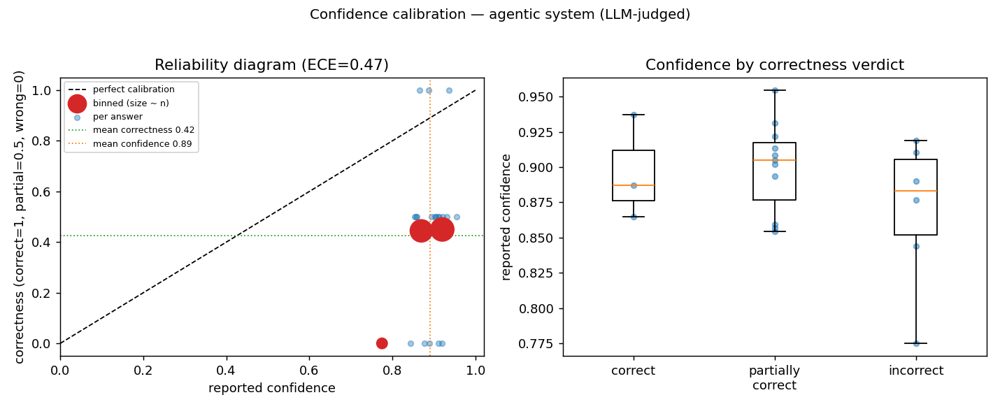

# Step 4 — Evaluation and Analysis

**Scope.** Quantitative + qualitative evaluation of the Step 3 reliable & adaptive
agentic RAG system: comparison against the Step 1 baseline, reliability-oriented
metrics, a reliability-focused benchmark extension, an ablation study over the
core mechanisms, and a qualitative + limitations discussion.

**Artifacts this draws on**
- Runs: `results/agentic/` (full, 25 q), `results/agentic/{no_recovery,no_abstain,no_clarify}/` (ablations, 25 q), `results/agentic/reliability/` (extension, 15 cases).
- Ground truth: `Baseline/benchmark/reliability_labels.json` (expected behaviour per original question), `Baseline/benchmark/benchmark_reliability.json` (extension cases + expected behaviour).
- Harness: `src/scripts/evaluate_agentic.py` → per-run `evaluation.md` + `evaluation_metrics.json`.
- Baseline: `results/baseline/metrics_summary.csv`.

System config: generation/verifier `claude-opus-4-7`, utility `claude-haiku-4-5`, retry budget 2, thresholds `sufficiency<0.40`, `grounding<0.60`, `contradiction>0.50`, `clarify_sufficiency_max 0.65`.

---

## 1. Metrics used and why

| Metric | Why it is appropriate |
|---|---|
| P@5, Recall@5, MRR@5 (final retrieved chunks vs. qrels) | Same retrieval family as Step 1, so the agentic system's final evidence can be compared apples-to-apples to the baseline. |
| Grounded-answer rate, unsupported-claim rate | Core reliability: does every answer stay within the evidence? (verifier output) |
| Answer correctness (LLM-judged vs. gold) | Quality: grounded ≠ correct, so we score factual answers against the gold answers separately. |
| Correct / false abstention rate | The defining abstention behaviour: declining when truly unanswerable (correct) vs. when evidence existed (false). |
| Correct / false clarification rate | Whether clarification fires on genuinely ambiguous queries. |
| Recovery success rate | Whether adaptive recovery actually rescues queries into grounded answers. |
| Confidence ↔ correctness alignment | Calibration of the reported trust score (also Extra-Challenge #2). |
| Latency + approximate cost | Efficiency / tradeoff axis. |

Answer-quality metrics are reported via LLM-judged correctness rather than BLEU/ROUGE because most benchmark answers are short factual strings or open-ended lists, where n-gram overlap is misleading; semantic correctness judged against the gold answer is the meaningful signal.

---

## 2. Headline: agentic system vs. Step 1 baseline

| Dimension | Step 1 baseline (best: Confidence) | Agentic (full) |
|---|---|---|
| Retrieval P@5 | 0.117 | **0.142** |
| Retrieval Recall@5 | 0.005 | **0.027** |
| Retrieval MRR | 0.205 | **0.218** |
| Answer generation | none (retrieval-only) | grounded, cited, verified |
| Grounded-answer rate | n/a | **1.00** |
| Unsupported claims / answer | n/a | **0.00** |
| Abstains on unanswerable | no | yes (Q1) |
| Latency (avg) | ~1 s | ~29 s |

The agentic system modestly improves retrieval (recovery + per-query mode switching pull more gold into the top-5 than any single fixed strategy) **and** adds the entire reliability layer the baseline lacked: every answer is grounded with zero unsupported claims, and the system declines rather than fabricating when evidence is absent. The cost is latency (LLM calls + recovery loops) and ~$0.04/query.

---

## 3. Reliability-oriented results (full run, 25 q)

**Action distribution:** 20 answer, 4 abstain, 1 clarify.

**Behaviour vs. expected (rows = expected, cols = actual):**

| expected \ actual | answer | abstain | clarify |
|---|---|---|---|
| answer (21) | 17 | 3 | 1 |
| abstain (1) | 0 | 1 | 0 |
| clarify (3) | 3 | 0 | 0 |

| Reliability metric | Value |
|---|---|
| Grounded-answer rate | **1.00** |
| Mean grounding score | 0.985 |
| Unsupported claims / answer | 0.00 |
| Answer coverage on answerable | 17/21 (**0.81**) |
| Correct abstention | 1/1 (Q1, out of corpus) |
| **False abstention rate** | **0.75** (3/4 — Q6, Q17, Q18: evidence exists but retrieval missed it) |
| Clarification correct | 0/1 (Q5 mis-clarified) |
| Recovery success | 7/11 (**0.64**) |

**Reading.** The verifier + abstention combination delivers a hard groundedness guarantee, but the conservative ambiguity calibration (from the Step 3 fix) means the 3 ambiguous-by-design questions are answered rather than clarified, and 3 answerable questions are *falsely* abstained because the retrievers cannot surface evidence that exists in the corpus (the Step 1 `ranking_failure`/`retrieval_failure` cases persist). Reliability here = "never hallucinate," achieved partly by declining when retrieval is weak.

---

## 4. Groundedness ≠ correctness (the key finding)

LLM-judged correctness of the 20 answers (against gold answers):

| Verdict | Count | Mean confidence |
|---|---|---|
| correct | 3 | 0.896 |
| partially_correct | 11 | 0.900 |
| incorrect | 6 | 0.869 |

Two important conclusions:

1. **Grounding guarantees faithfulness, not accuracy.** Every answer is grounded in its retrieved chunks (1.0 rate), yet only 3/20 fully match the gold answer and 6 are wrong. The answers are faithful to *the evidence that was retrieved* — but when retrieval surfaces incomplete or off-target chunks (the dominant Step 1 failure mode), a perfectly grounded answer is still incomplete or incorrect. **The bottleneck is retrieval, not generation or verification.** The reliability mechanisms successfully prevent hallucination; they cannot manufacture evidence the retriever never found.

2. **Confidence is poorly calibrated.** Mean confidence is essentially flat across correct (0.896), partial (0.900), and incorrect (0.869) verdicts. Because confidence is built from sufficiency + grounding, it tracks *faithfulness to retrieved chunks*, which is uniformly high — so it cannot discriminate correct from incorrect answers.

### Extra-Challenge #2 — confidence calibration

Quantifying the above (`src/scripts/calibration_plot.py`, verdicts mapped to
correct=1.0 / partial=0.5 / incorrect=0.0):

| Quantity | Value |
|---|---|
| Mean reported confidence | 0.890 |
| Mean correctness (graded) | 0.425 |
| Strict accuracy (correct only) | 0.150 |
| **Expected Calibration Error (ECE)** | **0.465** |
| Overconfidence gap (conf − acc) | **+0.465** |

The reliability diagram sits far **below** the diagonal: the system reports ~0.89
confidence while being right (graded) ~0.42 of the time — severe overconfidence
with ECE 0.47. The cause is structural: confidence is `0.4·sufficiency +
0.4·grounding + 0.2·(1−contradiction)`, and grounding is ~1.0 on every answer, so
the score saturates near the top regardless of whether the retrieved evidence was
the *right* evidence. A faithful answer over wrong chunks scores as highly as a
correct one. **Fixing this requires a correctness-correlated signal** — retrieval
quality (e.g. rerank score, gold-chunk overlap proxy), cross-source agreement, or
a learned calibrator — rather than more grounding. This is the most actionable
single improvement for trustworthiness.

---

## 5. Ablation study (original 25 q)

Each ablation disables one mechanism; all else equal.

| Config | answer | abstain | clarify | Answer coverage | False-abstain rate | Recovery success | Grounded rate | Cost | Latency avg |
|---|---|---|---|---|---|---|---|---|---|
| **full** | 20 | 4 | 1 | **0.81** | 0.75 | 0.64 | 1.00 | $0.95 | 28.7 s |
| **no_recovery** | 13 | 10 | 2 | **0.52** | 0.90 | — | 1.00 | $0.58 | 11.2 s |
| **no_abstain** | 24 | 0 | 1 | 0.95 | n/a | 1.00 | 1.00\* | $0.97 | 18.0 s |
| **no_clarify** | 21 | 4 | 0 | 0.86 | 0.75 | 0.64 | 1.00 | $0.96 | 16.7 s |

**(G) Adaptive recovery is the highest-value mechanism.** Disabling it collapses answer coverage from **0.81 → 0.52** and nearly triples abstentions (4 → 10): without query rewriting + mode switching, queries whose type-default retrieval is weak have no second chance and abstain. This is direct evidence that the *adaptation requirement* mechanism does meaningful work — it is what lets the system answer where a fixed pipeline would give up. (It also explains the latency: recovery loops are the main cost.)

**(E) Abstention trades coverage for honesty.** `no_abstain` answers 24/25, but inspection shows the gained "answers" are vacuous grounded non-answers — e.g. Q1 becomes "the evidence does not contain who was president in 2003." So grounded-rate stays 1.0\* only because *stating the evidence is silent* is itself grounded. Abstention's value is making that "I don't know" an explicit, honest action rather than a verbose non-answer.

**(D) Clarification has low impact at current calibration.** `no_clarify` differs from full by exactly one question (Q5), because the conservative profiler rarely flags ambiguity on the original benchmark. Clarification's value shows up on the extension (§6), not here.

\* `no_abstain` grounded-rate is 1.0 by the metric's definition; the qualitative content of the forced answers is weaker than the number suggests.

---

## 6. Benchmark extension (15 reliability-focused cases)

Authored cases across five categories, each tagged with expected behaviour
(`Baseline/benchmark/benchmark_reliability.json`). Outcomes:

| Category | Cases | Behaviour | Verdict |
|---|---|---|---|
| **Ambiguous** | R1, R2, R3 | R2, R3 → **clarify** ✅; R1 → answer **but the answer explicitly states it is ambiguous** and lists candidates | clarification fires on genuine ambiguity (2/3 clean) |
| **Insufficient evidence** | R4, R5, R6 | R4, R5 → **abstain** ✅; R6 → answer **but states the count is not in the evidence** (no fabricated number) | no fabrication on any (2/3 clean abstain) |
| **Adversarial / false premise** | R10, R11, R12 | R11, R12 → **abstain** ✅; R10 → answer with *real adjacent* info (2018 accreditation), **did not confabulate** the false "lost university status" premise | **0/3 confabulations** — the key robustness result |
| **Conflicting evidence** | R7, R8, R9 | all → answer, grounded, **date-qualified** (e.g. "2016 record of 19,815 students; no more recent figure in evidence") | answers handle time-dependence honestly, but contradiction was **not** detected (see below) |
| **Multilingual / code-switched** | R13, R14, R15 | all → **answer** ✅ (German + DE/EN code-switch) | bilingual answering works |

Grounded-answer rate on the extension: **1.00**.

**Strengths demonstrated:** clarification and abstention generalise to genuinely
ambiguous / insufficient cases; the system **never confabulated on a false
premise** (it abstained or returned real adjacent facts); multilingual and
code-switched queries are answered.

**Limitation surfaced — contradiction detection did not fire.** The conflicting-evidence
cases (R7–R9) returned `contradiction ≈ 0` and `conflict_flag = false`. The
retriever surfaced a *temporally coherent* slice of chunks rather than two
conflicting figures in the same top-k, so there was nothing to contradict; the
model instead answered with one figure and qualified it by date. Mechanism (C)
is implemented and runs, but this corpus + retriever rarely produces an
intra-top-k conflict, so it is effectively untested. To exercise it properly,
future work should inject known-conflicting chunks into the context.

---

## 7. Qualitative examples (from the DecisionTraces)

| Case | Where | What it shows |
|---|---|---|
| Grounded answer | `results/agentic/traces/3.json` (Q3) | Names ERC recipients found in chunks, explicitly flags that further recipients exist but are unnamed; verifier grounding 1.0. |
| Adaptive recovery | `traces/1.json` (Q1) | bm25 → voting → graphrag with two LLM query rewrites, then abstains when no support is ever found. |
| Correct abstention | `traces/1.json` (Q1), `traces/6.json` (Q6) | Declines an out-of-corpus / unretrievable question instead of fabricating. |
| Clarification | `reliability/traces/R2.json`, `R3.json` | "How many students are enrolled?" → asks which year/programme. |
| Adversarial robustness | `reliability/traces/R11.json`, `R12.json` | Abstains on "when did ETH merge with UZH?" and the fake Literature Nobel. |
| Difficult failure | `traces/18.json` (Q18) | **False abstention**: gold evidence exists in the corpus (Step 1 had it in top-100) but the agentic retrieval did not surface it, so the system abstained — coverage lost to a retrieval gap. |

---

## 8. Tradeoffs

- **Reliability vs. coverage.** The system's groundedness guarantee is bought partly with abstention: when retrieval is weak it declines (false-abstain rate 0.75 on the original benchmark). Lowering the sufficiency/grounding thresholds would raise coverage at the risk of weaker answers.
- **Quality vs. latency/cost.** Recovery roughly doubles answer coverage but is the dominant latency/cost driver (~29 s and ~$0.04 per query vs. ~1 s retrieval-only baseline). The retry budget (2) is the main knob.
- **Faithfulness vs. accuracy.** Verification guarantees faithfulness cheaply; accuracy is gated by retrieval quality, which the reliability layer cannot fix on its own.
- **Precision vs. coverage of clarification.** Conservative ambiguity detection avoids the earlier over-clarification (22/25) but under-clarifies the original benchmark's ambiguous-by-design questions; the extension shows the trigger works when ambiguity is unmistakable.

---

## 9. Limitations & future work

1. **Retrieval is the accuracy ceiling.** Grounded but only 3/20 fully correct — better recall (e.g. cross-encoder rerank over the top-100, which Step 1 showed usually contains the gold) would raise correctness more than any further reliability tweak.
2. **Confidence is uncalibrated** (flat across verdicts). Fold retrieval-quality and answer-vs-gold-style signals into the trust score; report a calibration curve (Extra-Challenge #2).
3. **Contradiction detection untested** on this corpus; needs forced-conflict cases.
4. **False abstentions** (Q6/Q17/Q18) are retrieval failures wearing an abstention mask — improving retrieval would convert several abstentions into correct answers.
5. **Threshold calibration** is currently hand-set; a sweep of `sufficiency_low` / `grounding_min` / `clarify_sufficiency_max` against these labels would optimise the coverage/reliability point.

---

## 10. Rubric deliverable mapping

| Step 4 deliverable | Where |
|---|---|
| Quantitative results with tables | §2–§6 + per-run `evaluation.md` / `evaluation_metrics.json` + `confidence_by_action.png` |
| Comparison against the baseline | §2 (retrieval) + §3–§4 (reliability the baseline lacked) |
| Reliability-focused benchmark extension | §6 + `benchmark_reliability.json` (15 cases, 5 categories) |
| ≥1 ablation study | §5 (three ablations: recovery / abstention / clarification) |
| Qualitative discussion + limitations | §7–§9 (trace examples, tradeoffs, limitations) |
