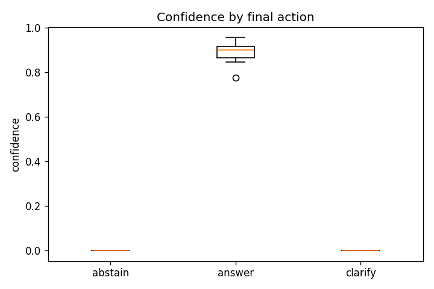

# Step 4 — Agentic System Evaluation

Run: `results\agentic`  |  questions: 25

## Action distribution
| action | n |
|---|---|
| abstain | 4 |
| answer | 20 |
| clarify | 1 |

## Behaviour vs. expected (reliability ground truth)
Confusion — rows = expected, cols = actual:

| expected \ actual | answer | abstain | clarify |
|---|---|---|---|
| answer | 17 | 3 | 1 |
| abstain | 0 | 1 | 0 |
| clarify | 3 | 0 | 0 |

- **Answer coverage on answerable**: 17/21 (rate 0.81)
- **Abstention**: 4 total — correct 1, false 3 (false-abstention rate 0.75)
- **Clarification**: 1 total — correct 0, false 1

## Groundedness (answered questions)
- grounded-answer rate: **1.0** (grounding ≥ 0.6)
- mean grounding score: 0.985
- mean unsupported claims per answer: 0.0

## Adaptive recovery
- queries that triggered recovery: 11 (Q1, Q10, Q12, Q13, Q17, Q18, Q19, Q20, Q23, Q4, Q6)
- recovery success (ended in grounded answer): 7 (rate 0.636)

## Confidence by action
| action | n | mean confidence |
|---|---|---|
| abstain | 4 | 0.0 |
| answer | 20 | 0.89 |
| clarify | 1 | 0.0 |

## Retrieval quality vs. Step 1 baseline
| system | P@5 | Recall@5 | MRR |
|---|---|---|---|
| Step 1 baseline (Confidence) | 0.1167 | 0.0046 | 0.2045 |
| Agentic (final top-5) | 0.1417 | 0.0273 | 0.2181 |

_computed on the agentic system's FINAL retrieved top-5 (post-recovery)._

## Answer correctness (LLM-judged, factual questions)
- judged: 20  |  verdicts: {'partially_correct': 11, 'correct': 3, 'incorrect': 6}
- mean confidence by verdict (calibration): {'partially_correct': 0.9, 'correct': 0.896, 'incorrect': 0.869}

## Efficiency
- latency avg/max: 28.74s / 251.89s
- approx. LLM cost (run): $0.9467

## Plots
