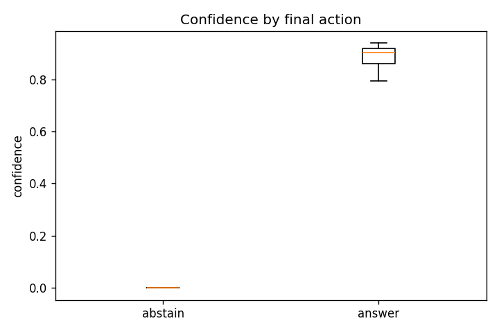

# Step 4 — Agentic System Evaluation

Run: `results\agentic\no_clarify`  |  questions: 25

## Action distribution
| action | n |
|---|---|
| abstain | 4 |
| answer | 21 |

## Behaviour vs. expected (reliability ground truth)
Confusion — rows = expected, cols = actual:

| expected \ actual | answer | abstain | clarify |
|---|---|---|---|
| answer | 18 | 3 | 0 |
| abstain | 0 | 1 | 0 |
| clarify | 3 | 0 | 0 |

- **Answer coverage on answerable**: 18/21 (rate 0.857)
- **Abstention**: 4 total — correct 1, false 3 (false-abstention rate 0.75)
- **Clarification**: 0 total — correct 0, false 0

## Groundedness (answered questions)
- grounded-answer rate: **1.0** (grounding ≥ 0.6)
- mean grounding score: 0.981
- mean unsupported claims per answer: 0.0

## Adaptive recovery
- queries that triggered recovery: 11 (Q1, Q10, Q12, Q13, Q17, Q18, Q19, Q20, Q4, Q5, Q6)
- recovery success (ended in grounded answer): 7 (rate 0.636)

## Confidence by action
| action | n | mean confidence |
|---|---|---|
| abstain | 4 | 0.0 |
| answer | 21 | 0.888 |

## Retrieval quality vs. Step 1 baseline
| system | P@5 | Recall@5 | MRR |
|---|---|---|---|
| Step 1 baseline (Confidence) | 0.1167 | 0.0046 | 0.2045 |
| Agentic (final top-5) | 0.0917 | 0.0053 | 0.1333 |

_computed on the agentic system's FINAL retrieved top-5 (post-recovery)._

## Efficiency
- latency avg/max: 16.69s / 31.55s
- approx. LLM cost (run): $0.963

## Plots
