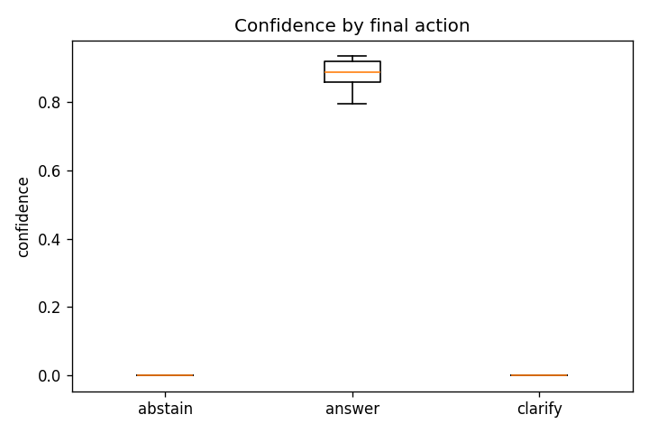

# Step 4 — Agentic System Evaluation

Run: `results\agentic\no_recovery`  |  questions: 25

## Action distribution
| action | n |
|---|---|
| abstain | 10 |
| answer | 13 |
| clarify | 2 |

## Behaviour vs. expected (reliability ground truth)
Confusion — rows = expected, cols = actual:

| expected \ actual | answer | abstain | clarify |
|---|---|---|---|
| answer | 11 | 8 | 2 |
| abstain | 0 | 1 | 0 |
| clarify | 2 | 1 | 0 |

- **Answer coverage on answerable**: 11/21 (rate 0.524)
- **Abstention**: 10 total — correct 1, false 9 (false-abstention rate 0.9)
- **Clarification**: 2 total — correct 0, false 2

## Groundedness (answered questions)
- grounded-answer rate: **1.0** (grounding ≥ 0.6)
- mean grounding score: 0.977
- mean unsupported claims per answer: 0.0

## Adaptive recovery
- no recovery triggered in this run

## Confidence by action
| action | n | mean confidence |
|---|---|---|
| abstain | 10 | 0.0 |
| answer | 13 | 0.883 |
| clarify | 2 | 0.0 |

## Retrieval quality vs. Step 1 baseline
| system | P@5 | Recall@5 | MRR |
|---|---|---|---|
| Step 1 baseline (Confidence) | 0.1167 | 0.0046 | 0.2045 |
| Agentic (final top-5) | 0.0917 | 0.004 | 0.1292 |

_computed on the agentic system's FINAL retrieved top-5 (post-recovery)._

## Efficiency
- latency avg/max: 11.16s / 18.97s
- approx. LLM cost (run): $0.5794

## Plots
