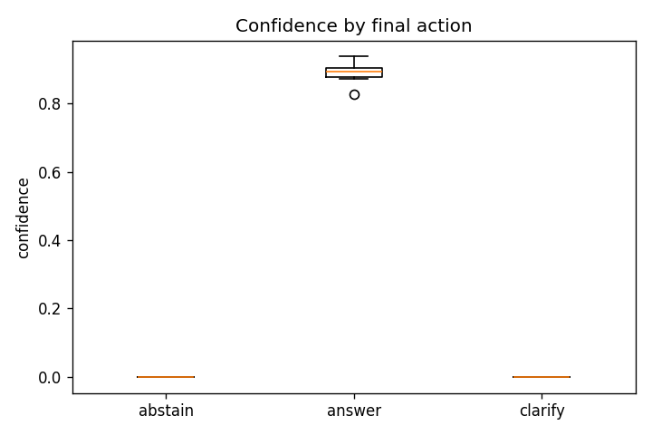

# Step 4 — Agentic System Evaluation

Run: `results\agentic\reliability`  |  questions: 15

## Action distribution
| action | n |
|---|---|
| abstain | 4 |
| answer | 9 |
| clarify | 2 |

## Behaviour vs. expected (reliability ground truth)
Confusion — rows = expected, cols = actual:

| expected \ actual | answer | abstain | clarify |
|---|---|---|---|
| answer | 6 | 0 | 0 |
| abstain | 2 | 4 | 0 |
| clarify | 1 | 0 | 2 |

- **Answer coverage on answerable**: 6/6 (rate 1.0)
- **Abstention**: 4 total — correct 4, false 0 (false-abstention rate 0.0)
- **Clarification**: 2 total — correct 2, false 0

## Groundedness (answered questions)
- grounded-answer rate: **1.0** (grounding ≥ 0.6)
- mean grounding score: 0.983
- mean unsupported claims per answer: 0.0

## Adaptive recovery
- queries that triggered recovery: 10 (QR10, QR11, QR12, QR13, QR4, QR5, QR6, QR7, QR8, QR9)
- recovery success (ended in grounded answer): 6 (rate 0.6)

## Confidence by action
| action | n | mean confidence |
|---|---|---|
| abstain | 4 | 0.0 |
| answer | 9 | 0.89 |
| clarify | 2 | 0.0 |

## Retrieval quality vs. Step 1 baseline

## Efficiency
- latency avg/max: 36.55s / 172.32s
- approx. LLM cost (run): $0.5508

## Plots
